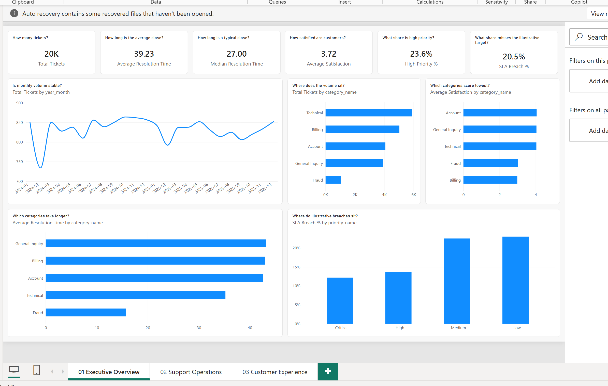
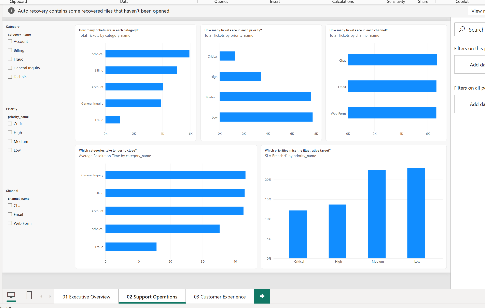
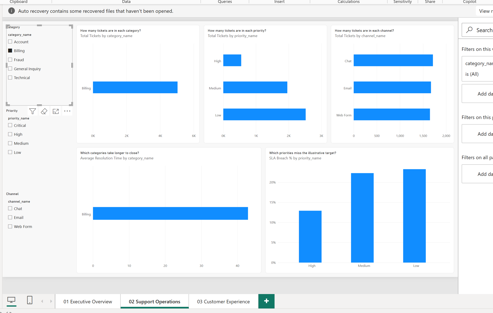
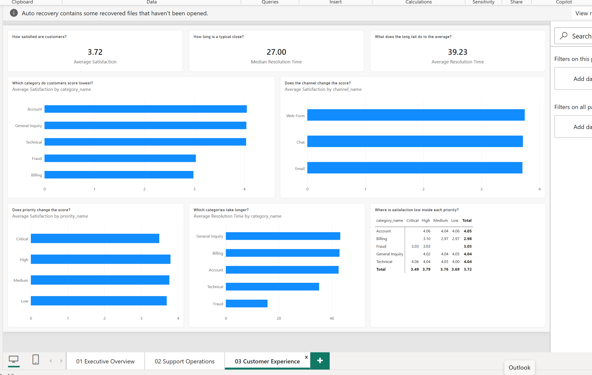

# Dashboard guide

The report is `dashboard/customer_support_dashboard.pbix`. It has three pages. Each visual answers a question someone can act on. Screenshots are in `docs/images/`.

The six report measures live on `fact_tickets` and only aggregate columns the SQL views already calculated:

| Measure | Result on the full model |
| --- | --- |
| Total Tickets | 20,000 |
| Average Resolution Time | 39.23 hours |
| Median Resolution Time | 27 hours |
| Average Satisfaction | 3.72 |
| High Priority % | 23.6% (4,714 tickets) |
| SLA Breach % | 20.5% (4,102 tickets) |

High priority is the `is_high_priority` flag (High, Critical, or Urgent). This extract has Critical and High only. SLA Breach % uses `sla_breach`. The hour targets are the project assumptions in [KPIs](kpis.md): Critical 24 hours, High 48, Medium and Low 72. They are illustrative targets for this project.

## What a VP can decide

- Plan capacity around a stable month. Volume stays about 730 to 870 tickets. February is the soft month. January 2026 is 18 tickets on one day, so the trend chart leaves that month out.
- Spend the satisfaction effort on Billing (5,036 tickets, score 2.98) and review Fraud (1,040 tickets, score 3.03). Account, General Inquiry, and Technical sit at about 4.04 to 4.05.
- Quote both resolution numbers. A typical ticket closes in 27 hours. The 39.23 hour average is the long tail.
- Treat the illustrative breach as a standard-queue problem. Medium is 22.5% and Low is 23.0%. Critical is 12.2% and already averages 12.1 hours against a 24 hour target.
- Leave the channel mix alone. Chat, Email, and Web Form each have about 6,650 tickets, and satisfaction sits between 3.71 and 3.75.
- A priority program will not fix Billing. Billing has no Critical tickets, and its score stays near 3.0 in High (3.10), Medium (2.97), and Low (2.97).

## 01 Executive Overview

| | |
| --- | --- |
| Audience | VP and anyone who needs the weekly picture |
| Questions | How many tickets are there? Is monthly volume stable? Where does the volume sit? Which categories score lowest? Which categories take longer? Where do illustrative breaches sit? |
| Key visuals | Six KPI cards. Ticket trend by month. Volume, satisfaction, and resolution time by category. Illustrative breach % by priority. |
| Decision | Staff to a flat ~850 tickets a month. Point the satisfaction work at Billing and Fraud. The breach rate to watch is Medium and Low, where most tickets already are. |

## 02 Support Operations

| | |
| --- | --- |
| Audience | Support operations manager |
| Questions | How many tickets are in each category, priority, and channel? Which categories take longer to close? Which priorities miss the illustrative target? |
| Key visuals | Slicers for category, priority, and channel. Volume by category, priority, and channel. Average resolution time by category. Illustrative breach % by priority. |
| Decision | Technical is the largest queue (5,918) and closes faster (35.2 hours) than Account, Billing, and General Inquiry (about 43 hours). Fraud is small and fast (15.8 hours). Channel volume is even, so channel is a weak basis for moving people. Use the slicers to check one queue before changing a roster. |

### Category filter check

Selecting Billing on the category slicer changes the other visuals. That is the relationship test: `dim_category` filters `fact_tickets`, and the priority, channel, resolution, and SLA visuals follow.

After the slicer is set to Billing:

- The category and resolution charts show only Billing.
- Billing is 5,036 tickets, about 42.9 hours, satisfaction 2.98, illustrative breach 21.7%.
- The priority chart drops Critical, because Billing has no Critical tickets (High 550, Medium 1,962, Low 2,524).
- The channel chart keeps Chat, Email, and Web Form, with the axis scaled to the smaller Billing volume.

The same filter in DAX returns 5,036 tickets, satisfaction 2.98, and breach 21.7%. The page and the model agree.

## 03 Customer Experience

| | |
| --- | --- |
| Audience | Customer experience lead |
| Questions | How satisfied are customers? How long is a typical close, and what does the long tail do to the average? Which category scores lowest? Does channel or priority change the score? Where is satisfaction low inside each priority? |
| Key visuals | Cards for satisfaction, median hours, and average hours. Satisfaction by category, channel, and priority. Resolution time by category. Matrix of satisfaction by category and priority. |
| Decision | Billing is low in every priority that has Billing tickets, so the fix is the billing experience, not a priority rule. Fraud is also low and already fast, so speed is the wrong lever there. Channel bars are level, which is the reason to skip a channel-specific satisfaction program. Keep reporting the 27 hour median next to the 39.23 hour average. |

The matrix totals match the category scores: Account 4.05, General Inquiry 4.04, Technical 4.04, Fraud 3.03, Billing 2.98, overall 3.72.
